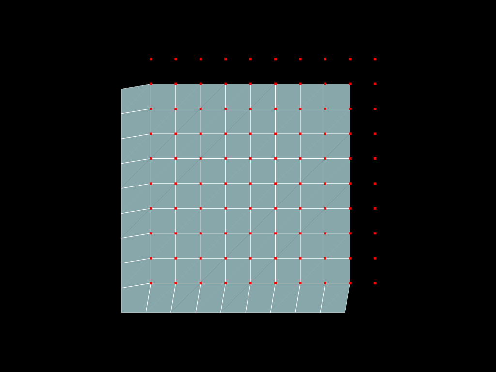
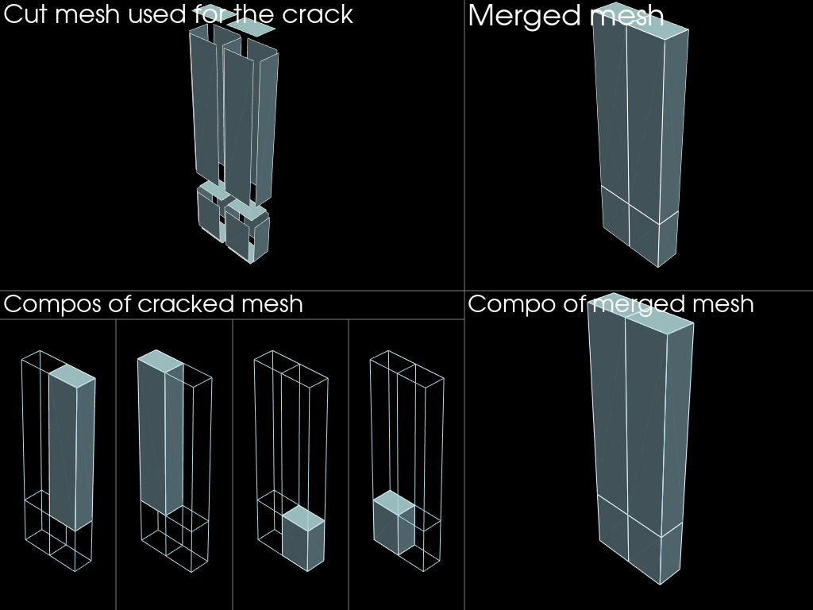
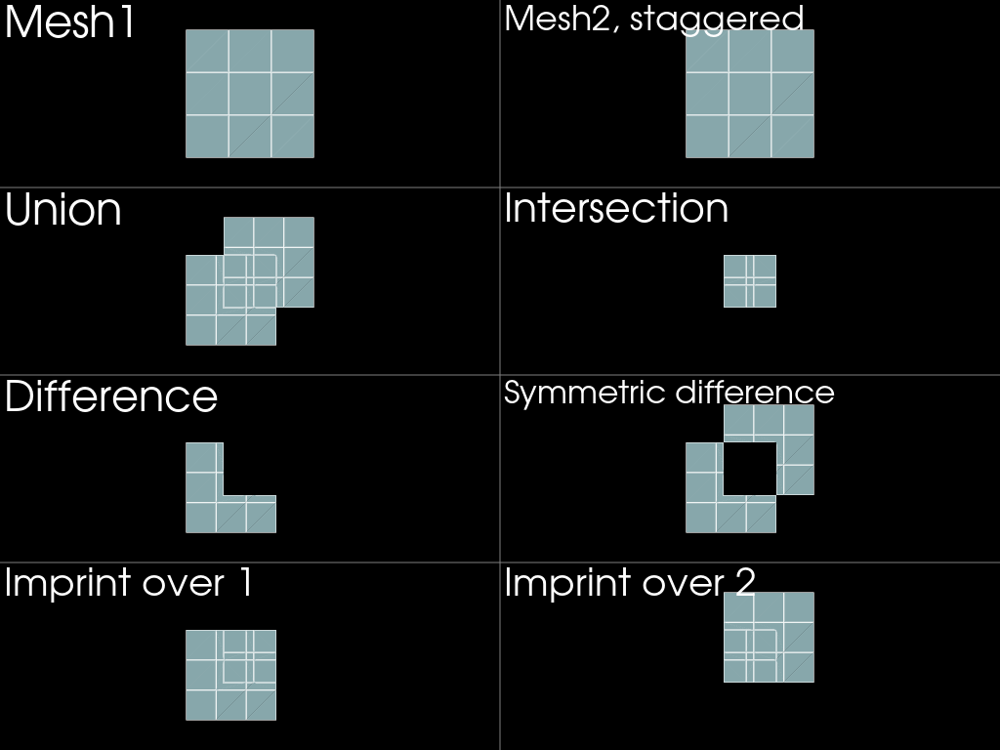
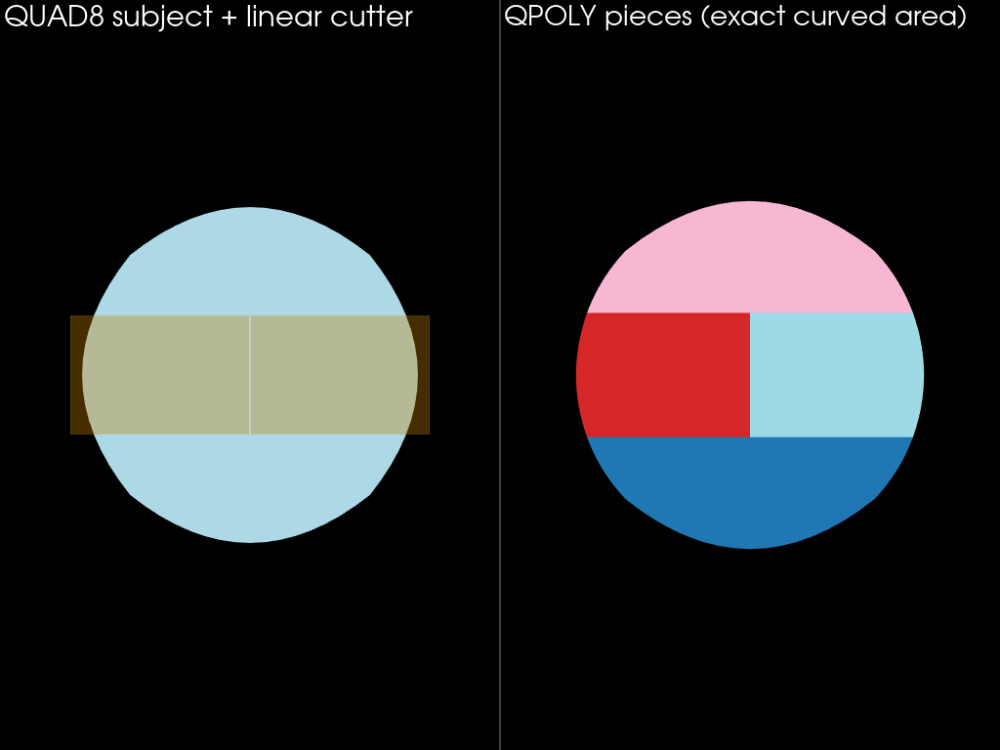
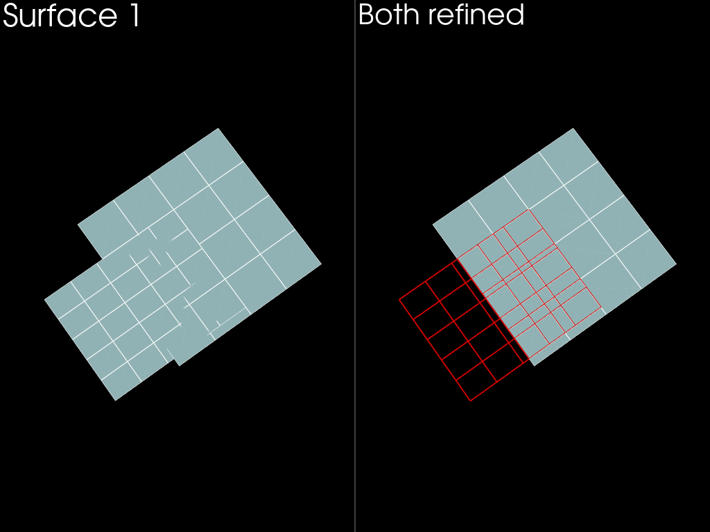

# Geometrical tools

*Figures use PyVista; verbose plotting boilerplate is omitted.*


```python
import numpy as np

import mefikit as mf
```

## Snap points

`mesh.snap(mesh2, eps)` moves the nodes of `mesh` so that they coincide with
the nodes of `mesh2` that are within `eps`. Below, two staggered grids are
offset by about one cell size:


```python
x = np.linspace(0.0, 3.0, 10, endpoint=True)
mesh = mf.build_cmesh(x, x)

eps = 0.1
dec = x[-1] / len(x) + eps
x2 = np.linspace(dec, x[-1] + dec, len(x), endpoint=True)
mesh2 = mf.build_cmesh(x2, x2)
```

**Note:** epsilon value used in the following operation is big enough so that there are multiple candidates for some points, but low enough so that there is no degenerated cell created.


```python
snaped = mesh.snap(mesh2, eps=x[-1] / len(x))
```





## Merge nodes

`merge_nodes()` collapses the duplicated nodes of a single mesh according to a
tolerance. It is the natural counterpart of `crack`: the mesh below was built
with a duplicated internal interface (hence many connected components), and the
merge re-glues it into one piece:


```python
x = range(2)
y = np.linspace(0.0, 3.0, 3, endpoint=True)
z = np.logspace(0.0, 1.0, 3, endpoint=True)
volumes = mf.build_cmesh(x, y, z)
faces = volumes.descend()
cracked = volumes.crack(faces)
```


```python
merged = cracked.merge_nodes()
```


```python
edges = faces.descend()
compos_merged = merged.connected_components()
compos_cracked = cracked.connected_components()

assert len(compos_merged) == 1

n_compos = len(compos_cracked)
```





## Overlay

`overlay` computes the boolean combination of two 2D meshes. The two grids
below are staggered by half a cell, and we apply the four classic operations
plus the two ways to imprint one grid into the other:

The intersection is valid in the following conditions :
- mesh1 and mesh2 are valid (no self recovering),
- mesh1 and mesh2 are 2d (xy),
- correctly oriented (CCW element connectivity),
- and fully merged (no unmerged nodes).

Mesh1 and mesh2 may have any number of 2d elements of the first order (TRI3, QUAD4, PGON).
`IMPRINT` additionally accepts a quadratic mesh1 (`TRI6`, `TRI7`, `QUAD8`, `QUAD9`, `QPOLY`)
cut by a first-order cutter. Quadratic edges are circular arcs and touched pieces are emitted
as `QPOLY`.


```python
x = np.linspace(0.0, 3.0, 4, endpoint=True)
mesh = mf.build_cmesh(x, x)

eps = 0.5
dec = x[-1] / len(x) + eps
x2 = np.linspace(dec, x[-1] + dec, len(x), endpoint=True)
mesh2 = mf.build_cmesh(x2, x2)

imprint2on1 = mesh.overlay(mesh2, mf.OverlayOperation.IMPRINT)
imprint1on2 = mesh2.overlay(mesh, mf.OverlayOperation.IMPRINT)

union = mesh.overlay(mesh2, mf.OverlayOperation.UNION)
diff = mesh.overlay(mesh2, mf.OverlayOperation.DIFFERENCE)
symdiff = mesh.overlay(mesh2, mf.OverlayOperation.SYMMETRIC_DIFFERENCE)
intersection = mesh.overlay(mesh2, mf.OverlayOperation.INTERSECTION)

meshes = [
    [mesh, mesh2],
    [union, intersection],
    [diff, symdiff],
    [imprint2on1, imprint1on2],
]
labels = [
    ["Mesh1", "Mesh2, staggered"],
    ["Union", "Intersection"],
    ["Difference", "Symmetric difference"],
    ["Imprint over 1", "Imprint over 2"],
]
```





The ugly cell in the center in the difference and symmetric difference comes from the plotting of non convex cells in pyvista. It is just a known plotting bug (due to optimisation quirks).

### Quadratic imprint

`IMPRINT` also accepts a quadratic subject mesh: `TRI6`, `TRI7`, `QUAD8`, `QUAD9` or `QPOLY`.
A quadratic edge is the circular arc through its two endpoints and its mid-side node. The
cutter stays first-order, and the quadratic mesh must be the subject (`mesh1`).

Touched pieces of quadratic cells are emitted as `QPOLY` with connectivity
`[v0, ..., vn-1, m0, ..., mn-1]`. Untouched cells keep their original type, and the mid nodes
of cut sub-arcs are recomputed on the same circle. The plot below converts QPOLY cells to quadratic triangles and lets PyVista subdivide them
with `extract_surface(nonlinear_subdivision=4)` for display; the area check uses the exact
circular-arc geometry. `to_pyvista` is left untouched.


```python
quad8_coords = np.array(
    [
        [0.0, 0.0],
        [1.0, 0.0],
        [1.0, 1.0],
        [0.0, 1.0],
        [0.5, -0.2],
        [1.2, 0.5],
        [0.5, 1.2],
        [-0.2, 0.5],
    ]
)
quadratic = mf.UMesh(quad8_coords)
quadratic.add_regular_block(
    "QUAD8", np.array([[0, 1, 2, 3, 4, 5, 6, 7]], dtype=np.uintp)
)
cutter = mf.build_cmesh([-0.25, 0.5, 1.25], [0.25, 0.75])
quadratic_imprint = quadratic.overlay(cutter, mf.OverlayOperation.IMPRINT)
print("result types:", quadratic_imprint.block_types())
print("QPOLY pieces:", len(quadratic_imprint.blocks()["QPOLY"][1]))
```

    result types: ['QPOLY']
    QPOLY pieces: 4


```python
def mesh_area(mesh):
    return sum(float(np.sum(values)) for values in mesh.measure().values())


area_before = mesh_area(quadratic)
area_after = mesh_area(quadratic_imprint)
print(f"curved area before imprint: {area_before:.12f}")
print(f"curved area after imprint:  {area_after:.12f}")
assert np.isclose(area_before, area_after, rtol=0.0, atol=1e-12)
```

    curved area before imprint: 1.550029315757
    curved area after imprint:  1.550029315757


```python
def qpoly_to_pyvista(mesh):
    """Represent QPOLY cells as quadratic triangles for PyVista rendering."""
    coords = np.asarray(mesh.coords(), dtype=float)
    if coords.shape[1] == 2:
        coords = np.hstack((coords, np.zeros((coords.shape[0], 1))))
    conn, offsets = mesh.blocks()["QPOLY"]
    conn = np.asarray(conn)
    offsets = np.asarray(offsets, dtype=int)
    starts = np.concatenate(([0], offsets[:-1]))
    points = list(coords)
    cells = []
    piece_ids = []

    def add_point(point):
        points.append([point[0], point[1], 0.0])
        return len(points) - 1

    for piece, (start, stop) in enumerate(zip(starts, offsets)):
        cell = conn[start:stop]
        n = len(cell) // 2
        vertices, mids = cell[:n], cell[n:]
        center = coords[vertices, :2].mean(axis=0)
        center_id = add_point(center)
        for i, v0 in enumerate(vertices):
            v1 = vertices[(i + 1) % n]
            mid_v1_center = add_point((coords[v1, :2] + center) / 2)
            mid_center_v0 = add_point((center + coords[v0, :2]) / 2)
            cells.extend(
                [
                    6,
                    int(v0),
                    int(v1),
                    center_id,
                    int(mids[i]),
                    mid_v1_center,
                    mid_center_v0,
                ]
            )
            piece_ids.append(piece)

    celltypes = np.full(len(piece_ids), pv.CellType.QUADRATIC_TRIANGLE, dtype=np.intp)
    grid = pv.UnstructuredGrid(np.asarray(cells), celltypes, np.asarray(points))
    grid.cell_data["piece"] = np.asarray(piece_ids)
    return grid.extract_surface(nonlinear_subdivision=4, algorithm="dataset_surface")


pt = pv.Plotter(shape=(1, 2))
pt.subplot(0, 0)
pt.add_text("QUAD8 subject + linear cutter")
pt.add_mesh(qpoly_to_pyvista(quadratic.polyze()), color="lightblue", lighting=False)
pt.add_mesh(cutter.to_pyvista(), show_edges=True, color="orange", opacity=0.35)
pt.camera_position = "xy"
pt.subplot(0, 1)
pt.add_text("QPOLY pieces (exact curved area)")
quadratic_pv = qpoly_to_pyvista(quadratic_imprint)
pt.add_mesh(
    quadratic_pv,
    scalars="piece",
    cmap="tab20",
    show_scalar_bar=False,
    lighting=False,
)
pt.camera_position = "xy"
pt.show(cpos="xy")
```





## Surface overlay

`overlay_surfaces` is the 3D counterpart of `overlay`: it imprints two 2D
surfaces (meshes embedded in 3D space) wherever they coincide.

`overlay_surfaces` imprints two 2D surfaces (meshes embedded in 3D space) wherever they
coincide. Both surfaces must be piecewise planar; here they are built in the plane `z = 0`
and tilted onto a common plane with the same `Transform`.

The two refined surfaces share their intersection nodes, so they become mutually
conformal on the overlap. Parts not covered by the other surface are copied verbatim.


```python
def quad_surface(extent, n):
    """Flat QUAD4 grid spanning extent=(xmin, xmax, ymin, ymax) in the plane z=0."""
    x = np.linspace(extent[0], extent[1], n + 1)
    y = np.linspace(extent[2], extent[3], n + 1)
    flat = mf.build_cmesh(x, y)
    coords = np.c_[flat.coords(), np.zeros(flat.coords().shape[0])]
    mesh = mf.UMesh(coords)
    mesh.add_regular_block("QUAD4", flat.blocks()["QUAD4"])
    return mesh


# Two quad surfaces with different sizes and discretizations on the same plane.
surface1 = quad_surface((0.0, 2.0, 0.0, 2.0), n=4)
surface2 = quad_surface((1.0, 2.8, 0.5, 1.9), n=5)

# Tilt both onto the same plane of 3D space (out-of-place transforms).
tilt = mf.Transform.rotation([1.0, 0.0, 0.0], -0.6) @ mf.Transform.rotation(
    [0.0, 1.0, 0.0], 0.5
)
surface1 = surface1.transform(tilt)
surface2 = surface2.transform(tilt)
```


```python
overlay = surface1.overlay_surfaces(surface2)
```





```python
# The refined surfaces are mutually conformal: they share the very same nodes.
assert np.array_equal(
    np.asarray(overlay.refined1.coords()), np.asarray(overlay.refined2.coords())
)

# The parents maps relate each input face to the elements it produced.
print("surface1:", len(overlay.parents1), "input faces")
print("surface2:", len(overlay.parents2), "input faces")
```

    surface1: 16 input faces
    surface2: 25 input faces
