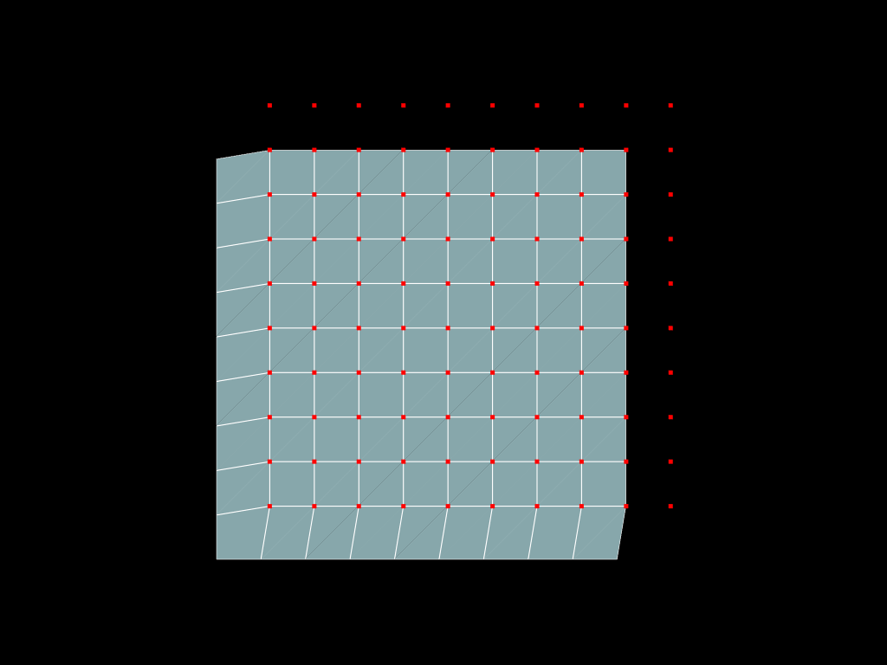
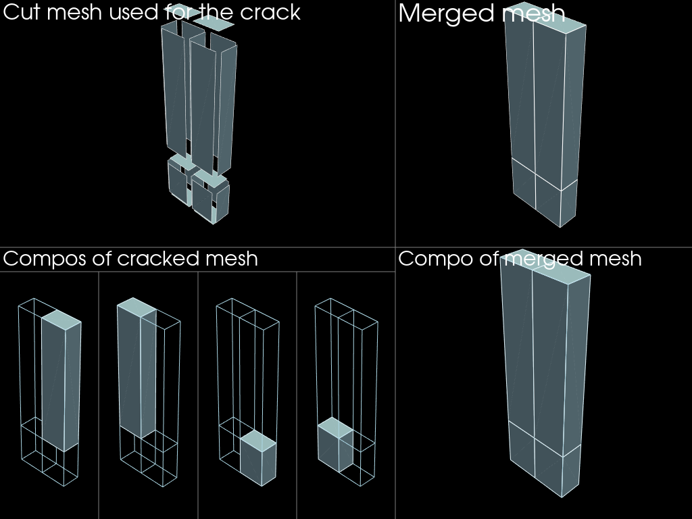

# Geometrical tools

*Figures use PyVista; verbose plotting boilerplate is omitted.*


```python
import numpy as np

import mefikit as mf
```

## Snap points

`mesh.snap(mesh2, eps)` moves the nodes of `mesh` so that they coincide with
the nodes of `mesh2` that are within `eps`. Below, two staggered grids are
offset by about one cell size:


```python
x = np.linspace(0.0, 3.0, 10, endpoint=True)
mesh = mf.build_cmesh(x, x)

eps = 0.1
dec = x[-1] / len(x) + eps
x2 = np.linspace(dec, x[-1] + dec, len(x), endpoint=True)
mesh2 = mf.build_cmesh(x2, x2)
```

**Note:** epsilon value used in the following operation is big enough so that there are multiple candidates for some points, but low enough so that there is no degenerated cell created.


```python
snaped = mesh.snap(mesh2, eps=x[-1] / len(x))
```





## Merge nodes

`merge_nodes()` collapses the duplicated nodes of a single mesh according to a
tolerance. It is the natural counterpart of `crack`: the mesh below was built
with a duplicated internal interface (hence many connected components), and the
merge re-glues it into one piece:


```python
x = range(2)
y = np.linspace(0.0, 3.0, 3, endpoint=True)
z = np.logspace(0.0, 1.0, 3, endpoint=True)
volumes = mf.build_cmesh(x, y, z)
faces = volumes.descend()
cracked = volumes.crack(faces)
```


```python
merged = cracked.merge_nodes()
```


```python
edges = faces.descend()
compos_merged = merged.connected_components()
compos_cracked = cracked.connected_components()

assert len(compos_merged) == 1

n_compos = len(compos_cracked)
```





## Overlay

Boolean and geometric combinations of meshes — 2D/2D booleans, quadratic
arc/arc imprints, 2D/1D cuts and 3D surface overlay — are covered in the
dedicated [Mesh overlay](./overlay.md) page.
