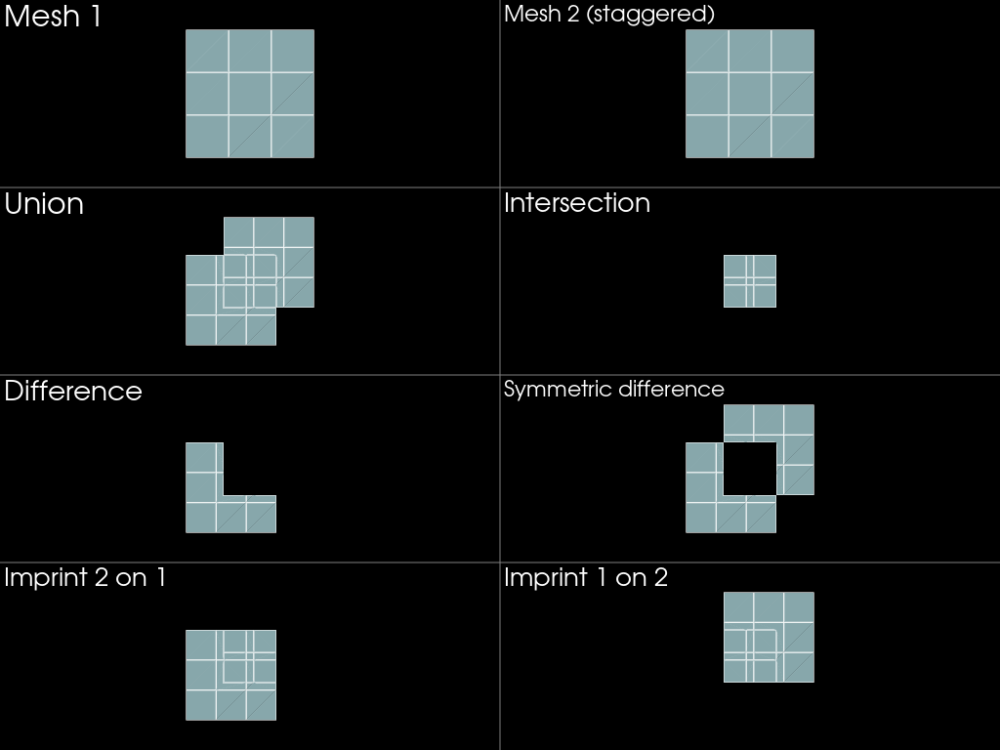
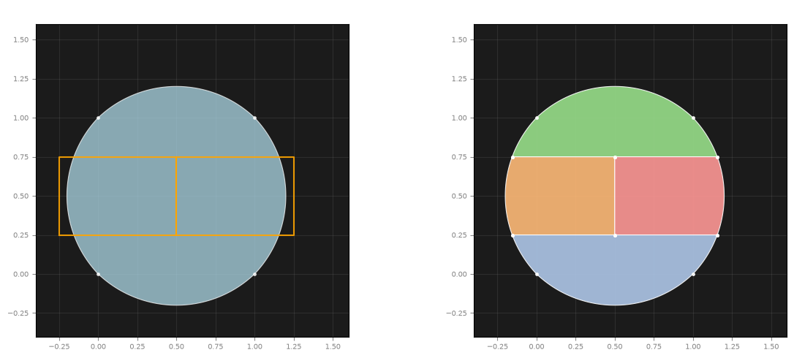
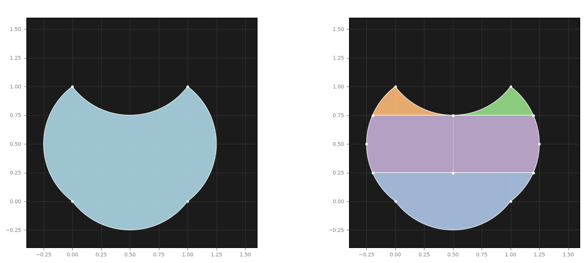
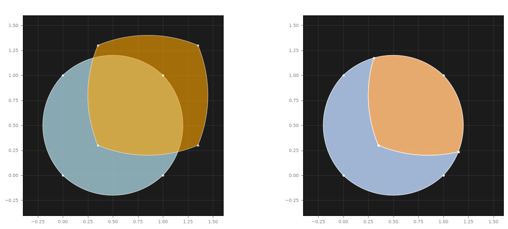
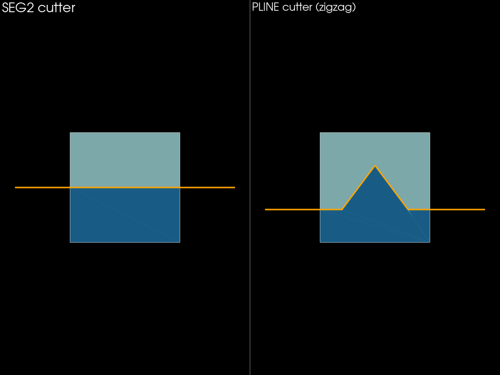
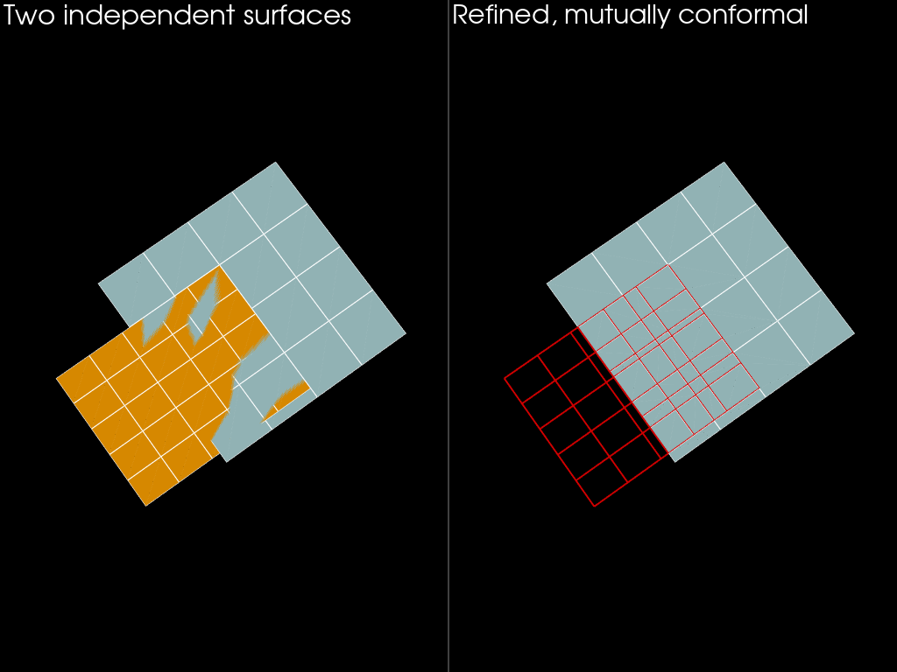

# Mesh overlay

Overlay operations combine two meshes by cutting one with the other's edges.
Mefikit exposes four families:

| Inputs | Method | Result |
|---|---|---|
| 2D + 2D, first order | `overlay(m2, op)` | `UNION`, `INTERSECTION`, `DIFFERENCE`, `SYMMETRIC_DIFFERENCE` or `IMPRINT` |
| 2D + 2D, quadratic | `overlay(m2, IMPRINT)` | subject refined by the cutter's **circular arcs** |
| 2D + 1D | `intersect_1d(lines)` | subject refined by `SEG2` / `PLINE` edges |
| 2D surfaces in 3D | `overlay_surfaces(m2)` | two mutually conformal surfaces |

*The 2D curved figures are drawn from the exact analytic arcs with Matplotlib;
the boolean, 1D and 3D figures use PyVista. Plotting boilerplate and mesh
builders are hidden. The visible cells contain only the operations: `quad8`
builds a single QUAD8 cell and `mesh_area` returns its exact area including the
circular segments.*


```python
import numpy as np

import mefikit as mf

OP = mf.OverlayOperation
```

## Boolean overlay (first-order meshes)

Two staggered QUAD4 grids are enough to show the five operations. `IMPRINT`
keeps the subject's domain and refines it with the other mesh's edges; the four
boolean operations select which pieces to keep.

| Operation | Keeps |
|---|---|
| `UNION` | everything covered by at least one mesh |
| `INTERSECTION` | the overlap |
| `DIFFERENCE` | the subject minus the other mesh |
| `SYMMETRIC_DIFFERENCE` | what belongs to exactly one mesh |
| `IMPRINT` | the whole subject, refined |

All five require first-order meshes (`TRI3`, `QUAD4`, `PGON`); passing a
quadratic mesh to a boolean operation raises `ValueError`.


```python
x = np.linspace(0.0, 3.0, 4)
mesh1 = mf.build_cmesh(x, x)
mesh2 = mf.build_cmesh(x + 1.25, x + 1.25)

results = {
    "Union": mesh1.overlay(mesh2, OP.UNION),
    "Intersection": mesh1.overlay(mesh2, OP.INTERSECTION),
    "Difference": mesh1.overlay(mesh2, OP.DIFFERENCE),
    "Symmetric difference": mesh1.overlay(mesh2, OP.SYMMETRIC_DIFFERENCE),
    "Imprint 2→1": mesh1.overlay(mesh2, OP.IMPRINT),
    "Imprint 1→2": mesh2.overlay(mesh1, OP.IMPRINT),
}
```





The ragged cell in the middle of *Difference* and *Symmetric difference* is a
PyVista rendering artefact for non-convex polygons, not a mesh defect.

## Quadratic edges are circular arcs

A quadratic 2D cell (`TRI6`, `TRI7`, `QUAD8`, `QUAD9`, `QPOLY`) stores its
boundary as `[vertices…, mid-side nodes…]`: each edge is the circular arc
through its two endpoints and its mid-side node. A collinear mid node
degenerates to a straight segment.

`IMPRINT` accepts quadratic cells on **both** sides. It intersects arcs with
segments or with other arcs and emits touched pieces as `QPOLY` whose mid-side
nodes are recomputed on the original circles — so the exact curved area is
preserved.


```python
subject = quad8(0.20)
cutter = mf.build_cmesh([-0.25, 0.5, 1.25], [0.25, 0.75])
imprinted = subject.overlay(cutter, OP.IMPRINT)
```


```python
before, after = mesh_area(subject), mesh_area(imprinted)
assert np.isclose(before, after, atol=1e-12)
print(f"exact curved area: {before:.9f} → {after:.9f}")
print("output types:", imprinted.block_types())
```

    exact curved area: 1.550029316 → 1.550029316
    output types: ['QPOLY']





### Concave arcs

An edge may also bulge *towards the interior* of the cell. That arc sweeps
clockwise instead of counter-clockwise, and the cut must still land on the
right branch of the circle. Concave cells are supported too — including a
cutter edge touching an arc tangentially: the resulting piece is then split at
the pinch point rather than emitted as a self-touching polygon.


```python
concave = quad8(0.25, inward=True)
concave_cut = concave.overlay(cutter, OP.IMPRINT)
assert np.isclose(mesh_area(concave), mesh_area(concave_cut), atol=1e-12)
```





### Arc ↔ arc: a quadratic cutter

Two different circles meet through their radical axis; two arcs on the same
circle share their overlap endpoints. The cutter's curved edges refine the
subject exactly where the arcs meet, and the new interface follows the
cutter's circular arc — not its chord. Outer arcs and the exact curved area
are preserved.


```python
other = quad8(0.10, shift=(0.35, 0.30))
arc_cut = subject.overlay(other, OP.IMPRINT)
assert np.isclose(mesh_area(subject), mesh_area(arc_cut), atol=1e-12)
print("refined pieces:", arc_cut.num_elements())
```

    refined pieces: 2





## Cutting a 2D mesh with a 1D mesh

`intersect_1d` is the 2D/1D counterpart of `IMPRINT`: the subject is refined
with the edges of a 1D mesh of `SEG2` or `PLINE` cells. A `PLINE` is split into
its consecutive `SEG2` edges, so both forms behave identically.

The 1D elements must not intersect one another. A closed polyline lying
strictly inside a cell is ignored — the result would be a cell with a hole,
which is not a valid element.


```python
plane = mf.build_cmesh([0.0, 1.0], [0.0, 1.0])

segments = mf.UMesh(np.array([[-0.5, 0.5], [0.5, 0.5], [1.5, 0.5]]))
segments.add_regular_block("SEG2", np.array([[0, 1], [1, 2]], dtype=np.uintp))
cut_by_seg2 = plane.intersect_1d(segments)
```


```python
zigzag = mf.UMesh(
    np.array([[-0.5, 0.3], [0.2, 0.3], [0.5, 0.7], [0.8, 0.3], [1.5, 0.3]])
)
zigzag.add_poly_block(
    "PLINE", np.arange(5, dtype=np.uintp), np.array([5], dtype=np.uintp)
)
cut_by_pline = plane.intersect_1d(zigzag)
print("SEG2 cutter:", cut_by_seg2.block_types(), cut_by_seg2.num_elements(), "cells")
print("PLINE cutter:", cut_by_pline.block_types(), cut_by_pline.num_elements(), "cells")
```

    SEG2 cutter: ['PGON'] 2 cells
    PLINE cutter: ['PGON'] 2 cells





## Surfaces in 3D

`overlay_surfaces` imprints two 2D surfaces embedded in 3D wherever they
coincide. Both must be piecewise planar. The refined surfaces share their
intersection nodes, so they become mutually conformal on the overlap; parts
not covered by the other surface are copied verbatim.


```python
surface1 = quad_surface((0.0, 2.0, 0.0, 2.0), 4)
surface2 = quad_surface((1.0, 2.8, 0.5, 1.9), 5)
tilt = mf.Transform.rotation([1.0, 0.0, 0.0], -0.6) @ mf.Transform.rotation(
    [0.0, 1.0, 0.0], 0.5
)
surface1, surface2 = surface1.transform(tilt), surface2.transform(tilt)
surfaces = surface1.overlay_surfaces(surface2)
```


```python
assert np.array_equal(
    np.asarray(surfaces.refined1.coords()), np.asarray(surfaces.refined2.coords())
)
print("input faces:", len(surfaces.parents1), "+", len(surfaces.parents2))
```

    input faces: 16 + 25





## Rules and current limits

- Input meshes must be valid, planar and correctly oriented (CCW), with
  coordinates in the same space.
- **Boolean operations are first-order only.** Their inside/outside
  classification assumes straight-edged cut pieces; passing `TRI6`, `TRI7`,
  `QUAD8`, `QUAD9` or `QPOLY` raises `ValueError`. `IMPRINT` has no such
  restriction and is exact on curved cells.
- A closed cutter loop strictly inside a cell is ignored (no holed cells).
- 1D cutters are assumed not to intersect one another.
- `overlay_surfaces` requires piecewise-planar first-order surfaces.
