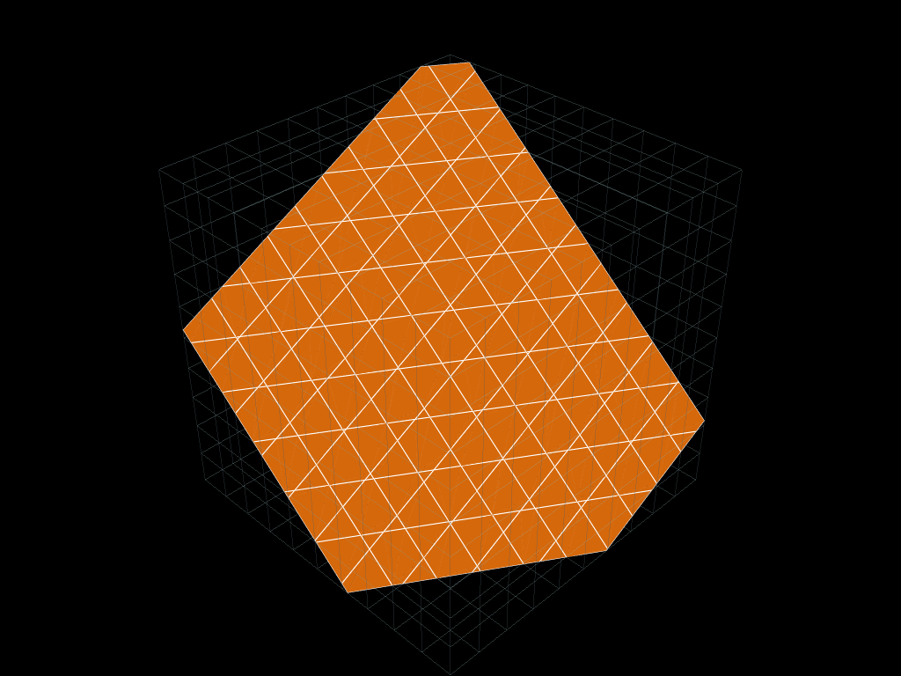
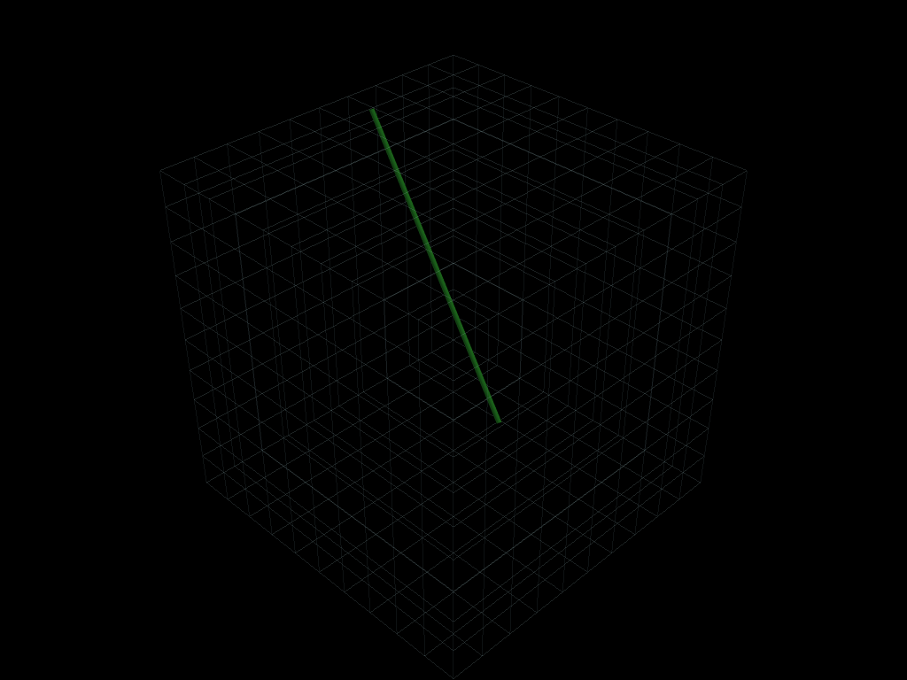
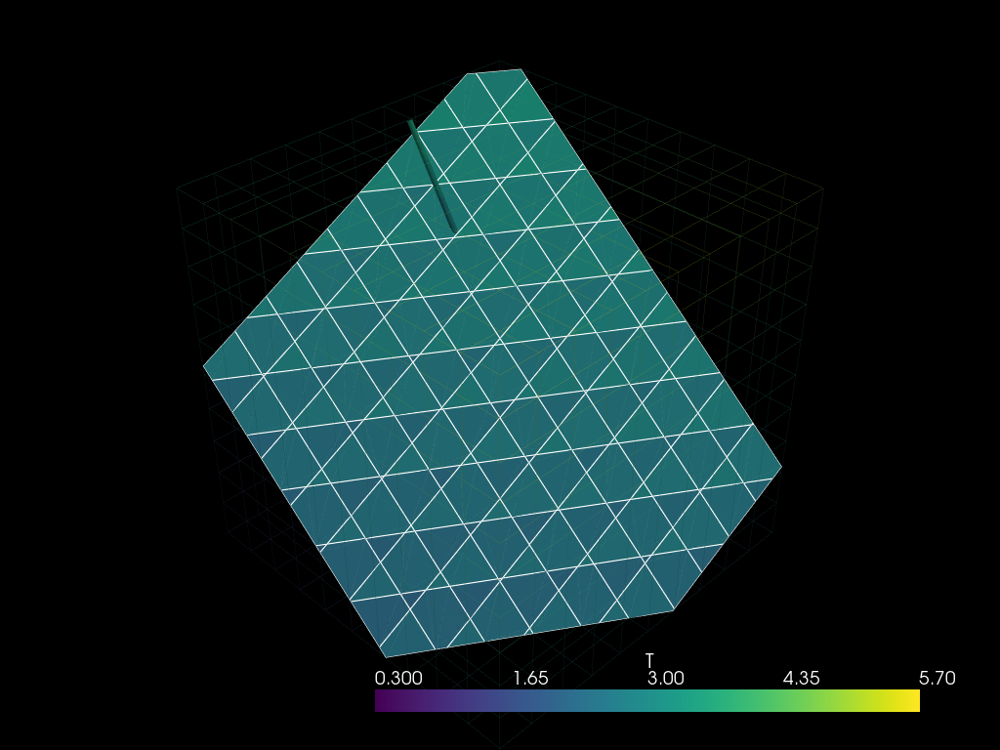
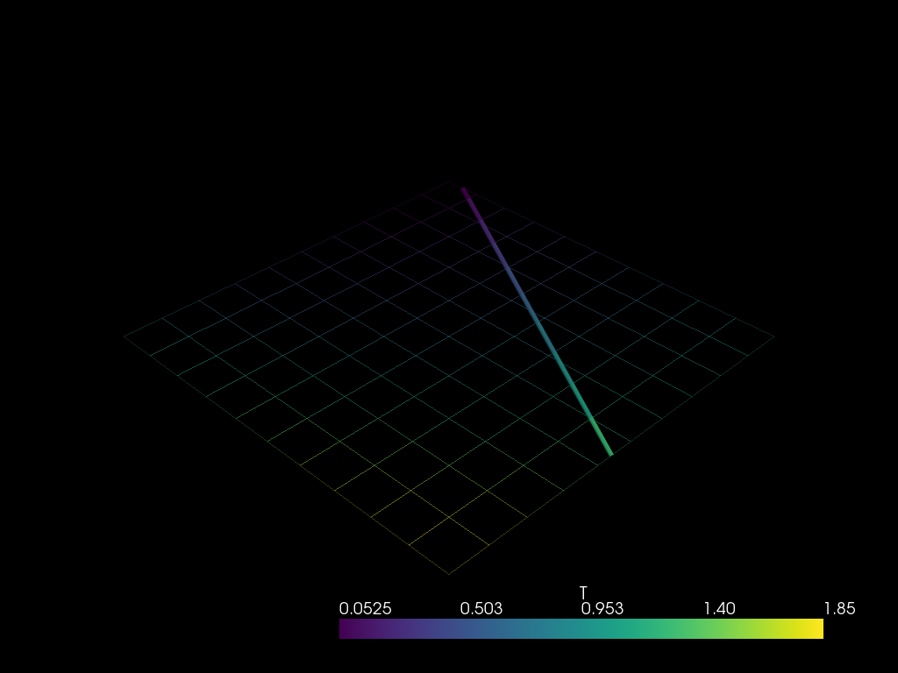

# Mesh slicing

*Figures use PyVista; verbose plotting boilerplate is omitted.*

`UMesh.slice(origin, normal)` cuts a mesh with a hyperplane and returns a mesh of
one dimension lower: a 3D volume becomes a 2D polygonal (`PGON`) surface
embedded in 3D, and a 2D region becomes a 1D `SEG2` line. In both cases the
hyperplane passes through `origin` and is normal to `normal`.


```python
import numpy as np

import mefikit as mf
```

## Slicing a 3D volume

Let us build a box and cut it with a general oblique plane, neither through a
mesh node nor aligned with an axis. The slice is a 2D mesh made of polygons,
but its coordinates remain in 3D so it can be plotted with the source volume.


```python
axis = np.linspace(0.0, 1.0, 11)
volume = mf.build_cmesh(axis, axis, axis)

origin = np.array([0.37, 0.42, 0.51])
normal = np.array([0.7, 1.1, 1.3])
surface = volume.slice(origin, normal)

surface.block_types(), surface.coords().shape
```


    (['PGON'], (240, 3))


```python
_, offsets = surface.blocks()["PGON"]
sizes, counts = np.unique(np.diff(offsets), return_counts=True)
dict(zip(sizes.tolist(), counts.tolist()))
```


    {3: 92, 4: 53, 5: 29, 6: 33}


The output only contains the intersection of the volume with the plane. The
cells are `PGON`s, even when the section is a quadrilateral. Here the general
cut produces triangles, quadrilaterals, pentagons and hexagons.


```python
plotter = pv.Plotter()
plotter.add_mesh(volume.to_pyvista(), style="wireframe", opacity=0.15)
plotter.add_mesh(surface.to_pyvista(), show_edges=True, color="tab:orange")
plotter.show()
```





## Slicing a 3D volume along a line

`slice_line(origin, direction)` cuts the volume with the line through `origin`
along `direction`. Here we use a general oblique line that does not pass
through any mesh node. The result is a 1D `SEG2` mesh whose coordinates remain
in 3D, so it can be drawn on top of the volume.


```python
line3d = volume.slice_line([0.23, 0.37, 0.11], [0.2, -0.3, 1.0])
line3d.block_types(), line3d.coords().shape
```


    (['SEG2'], (16, 3))


```python
plotter = pv.Plotter()
plotter.add_mesh(volume.to_pyvista(), style="wireframe", opacity=0.1)
plotter.add_mesh(
    line3d.to_pyvista(dim="all"),
    color="tab:green",
    line_width=6,
    render_lines_as_tubes=True,
)
plotter.show()
```





## Transferring a field onto the slice

Slicing does not copy fields, because the target cells are not the source
cells. The `mf.transfer` operators remap them. `ConstantPiecewise` samples the
volume cell containing each slice-cell centroid, which is a natural choice for
a piecewise-constant field; `MovingLeastSquares` or `InverseDistance` can be
used when a smoother result is wanted.


```python
volume.fields["T"] = mf.X + 2.0 * mf.Y + 3.0 * mf.Z

surface_transfer = mf.transfer.ConstantPiecewise(volume, surface)
surface.fields["T"] = surface_transfer("T")

line_transfer = mf.transfer.ConstantPiecewise(volume, line3d)
line3d.fields["T"] = line_transfer("T")

surface.fields["T"].values()["PGON"][:5]
```


    array([2.1, 2.2, 2.1, 2.2, 2.3])


The slice now carries `T`, and the values follow the analytic field
`T(x, y, z) = x + 2y + 3z` sampled in the volume cells:


```python
plotter = pv.Plotter()
plotter.add_mesh(volume.to_pyvista(), style="wireframe", opacity=0.1)
plotter.add_mesh(surface.to_pyvista(), scalars="T", show_edges=True)
plotter.add_mesh(
    line3d.to_pyvista(dim="all"),
    scalars="T",
    line_width=6,
    render_lines_as_tubes=True,
)
plotter.show()
```





## Slicing a 2D mesh

In 2D the cut is a line. Here we use a general oblique line that does not pass
through mesh nodes; the result is a `SEG2` mesh. Its field is transferred in
the same way.


```python
domain = mf.build_cmesh(axis, axis)
line = domain.slice_line([0.13, 0.27], [1.0, 1.7])

domain.fields["T"] = mf.X**2 + mf.Y
line.fields["T"] = mf.transfer.ConstantPiecewise(domain, line)("T")

line.block_types(), line.coords().shape
```


    (['SEG2'], (16, 2))


```python
plotter = pv.Plotter()
plotter.add_mesh(domain.to_pyvista(), style="wireframe", opacity=0.35)
plotter.add_mesh(
    line.to_pyvista(dim="all"), scalars="T", line_width=6, render_lines_as_tubes=True
)
plotter.show()
```



